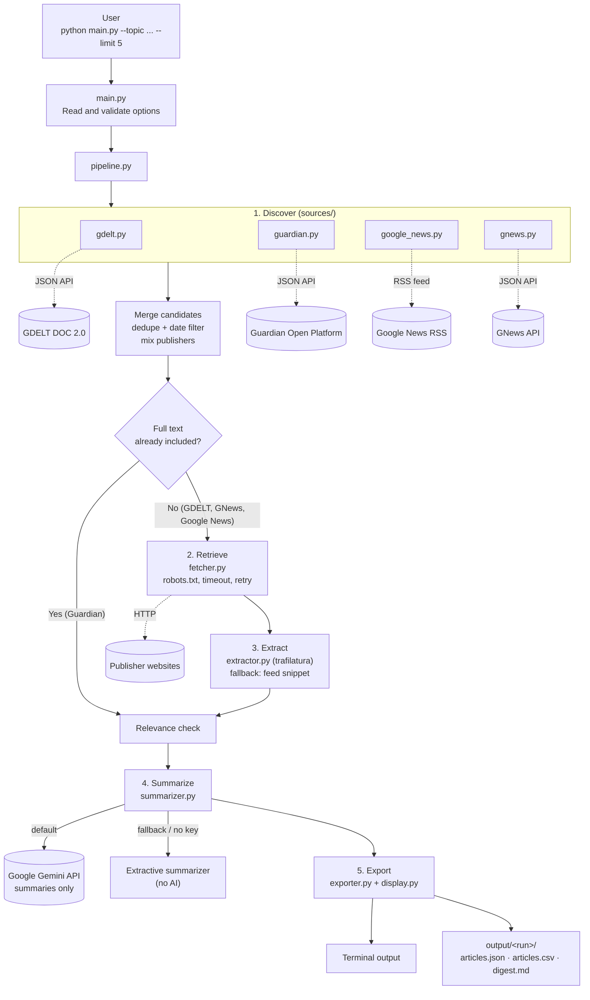

# NewsPulse

**Automated news discovery and summarization from the command line.**

You give NewsPulse a topic, such as *"electric vehicles"*, *"cybersecurity"* or
*"AI regulation"*. It searches public news sources for recent articles, extracts
the article text, removes duplicates and off-topic results, and writes a short
summary of each article with a link back to the original.

```bash
python main.py --topic "cybersecurity" --limit 5
```

All news discovery and retrieval is done by Python code using public APIs, RSS
feeds and HTTP requests. **No LLM, chatbot or AI search tool is used to find,
select, fetch or extract articles.** Google Gemini is used only to summarize text
that the code has already collected, and a non-AI summarizer is built in as a
fallback.

---

## Table of contents

- [What it does](#what-it-does)
- [How it works](#how-it-works)
- [Architecture](#architecture)
- [Tech stack](#tech-stack)
- [Project structure](#project-structure)
- [Setup](#setup)
- [How to run](#how-to-run)
- [Output](#output)
- [Sample run](#sample-run)
- [Running tests](#running-tests)
- [Design notes](#design-notes)
- [Known limitations](#known-limitations)
- [Future improvements](#future-improvements)

---

## What it does

| Requirement | How NewsPulse handles it |
|-------------|--------------------------|
| Topic input | Passed with `--topic`, or asked for interactively if missing |
| Article limit | `--limit` option (default 5) |
| Two or more sources | GDELT, The Guardian API and Google News RSS, covering many publishers |
| Recent news | Keeps articles from the last 7 days by default (`--days` to change) |
| Metadata | Title, publisher, URL, publication date, retrieval time, article text |
| Missing data | Kept as `null` and listed in each article's `missing_fields` |
| Summaries | 2–4 sentences per article, based only on the collected text |
| Output | `articles.json`, `articles.csv` and a readable `digest.md`, plus results in the terminal |
| Reliability | Deduplication, relevance filtering, timeouts, retries, per-source error handling |
| Shortfall | If fewer articles than requested are found, the output says so and why; nothing is invented |

---

## How it works

Every run goes through six steps:

1. **Input.** Reads the topic, article limit, day range and summarizer choice.
2. **Discover.** Searches four sources for the topic:
   - **GDELT DOC 2.0 API**: a global news index with direct publisher links (no key needed)
   - **The Guardian Open Platform API**: returns the full article text (free key)
   - **GNews API**: news search across many publishers with direct article links (free key)
   - **Google News RSS**: broad coverage of many publishers (no key needed)
3. **Retrieve.** For GDELT, GNews and Google News results, downloads each article page
   with `requests`. Google News redirect links are first decoded to the real
   publisher URL. Requests use a clear user agent, timeouts, retries and a polite
   delay, and respect `robots.txt`. Paywalls, logins and CAPTCHAs are never
   bypassed. Guardian articles skip this step because the API already provides
   the text.
4. **Clean.** `trafilatura` extracts the main article text and skips menus, ads and
   comments. Articles are filtered by date and topic relevance, duplicates are
   removed by URL and by near-identical headline, and results are mixed across
   publishers. If a page can't be fetched, the source's short snippet is used
   instead and marked `feed_excerpt`.
5. **Summarize.** Gemini receives only the extracted text and is instructed to
   summarize it in 2–4 sentences using nothing else. If no Gemini key is set or a
   request fails, the extractive summarizer picks the most important sentences
   straight from the article.
6. **Export.** Prints the results in the terminal and saves JSON, CSV and a
   Markdown digest.

If a source fails or blocks a request, the run continues with the other sources
and the error is reported in the output.

---

## Architecture



---

## Tech stack

| Tool | Used for |
|------|----------|
| Python 3.10+ | Core language |
| requests | HTTP requests with timeouts and retries |
| feedparser | Parsing the Google News RSS feed |
| googlenewsdecoder | Turning Google News redirect links into real publisher URLs |
| trafilatura | Extracting the main article text from web pages |
| RapidFuzz | Detecting near-duplicate headlines |
| Pydantic | Data models and validation |
| google-genai | Gemini summaries |
| Rich | Readable, colored terminal output |
| python-dotenv | Loading API keys from `.env` |
| pytest | Automated tests |

| Data source | Access | Provides |
|-------------|--------|----------|
| GDELT DOC 2.0 API | Public, no key | Article links, titles, dates, publisher domains |
| The Guardian Open Platform | Free developer key | Article links, titles, dates and full text |
| GNews API | Free API key | Article links, titles, publishers, dates, short descriptions |
| Google News RSS | Public, no key | Article links, titles, publishers, dates |

---

## Project structure

```
newspulse-project/
├── main.py                  # Entry point (command-line options)
├── newspulse/
│   ├── __init__.py
│   ├── config.py            # Settings and environment variables
│   ├── models.py            # Article and RunResult data models
│   ├── pipeline.py          # Runs the full workflow from topic to results
│   ├── sources/
│   │   ├── __init__.py
│   │   ├── base.py          # Common interface and error handling for sources
│   │   ├── gdelt.py         # GDELT DOC 2.0 API
│   │   ├── guardian.py      # The Guardian Open Platform API
│   │   └── google_news.py   # Google News RSS + link decoding
│   ├── fetcher.py           # HTTP requests, retries, robots.txt, rate limiting
│   ├── extractor.py         # Article text extraction (trafilatura)
│   ├── filters.py           # Date, relevance and duplicate filtering
│   ├── summarizer.py        # Gemini and extractive summarizers
│   ├── exporter.py          # JSON, CSV and Markdown output
│   └── display.py           # Terminal output (Rich)
├── tests/                   # Automated tests with saved sample data
├── output/                  # Results from each run
├── samples/                 # Sample run included with the submission
├── requirements.txt
├── .env.example
└── .gitignore
```

---

## Setup

**You need:** Python 3.10 or newer, and Git.

### 1. Clone the repository

```bash
git clone https://github.com/<your-username>/newspulse-project.git
cd newspulse-project
```

### 2. Create a virtual environment

```bash
python -m venv venv

# macOS / Linux
source venv/bin/activate

# Windows
venv\Scripts\activate
```

### 3. Install dependencies

```bash
pip install -r requirements.txt
```

### 4. Add your API keys

```bash
# macOS / Linux
cp .env.example .env

# Windows
copy .env.example .env
```

Open `.env` and fill in your keys:

| Variable | Required | Default | Purpose |
|----------|----------|---------|---------|
| `GEMINI_API_KEY` | Recommended | none | Gemini summaries. Get a free key at [Google AI Studio](https://aistudio.google.com/apikey). Without it, the extractive summarizer is used. |
| `GEMINI_MODEL` | No | `gemini-3.8-flash` | Gemini model used for summaries |
| `GUARDIAN_API_KEY` | Recommended | none | The Guardian source. Get a free key at [Guardian Open Platform](https://open-platform.theguardian.com/access/). Without it, this source is skipped. |
| `GNEWS_API_KEY` | Optional | none | The GNews source. Get a free key at [GNews](https://gnews.io/). Without it, this source is skipped. |
| `REQUEST_TIMEOUT` | No | `10` | Seconds before a request gives up |

The program still runs with **no keys at all**. It uses GDELT and Google News
with the extractive summarizer.

Keys are read only from environment variables and are never stored in the code.
`.env` is listed in `.gitignore` so it is never committed.

---

## How to run

```bash
python main.py --topic "<topic>" [options]
```

| Option | Default | Description |
|--------|---------|-------------|
| `--topic` | *(asks if missing)* | Topic or keywords to search for |
| `--limit` | `5` | Maximum number of articles (1–50) |
| `--days` | `7` | Only keep articles from the last N days (1–30) |
| `--summarizer` | `gemini` | `gemini` or `extractive` (no AI) |
| `--format` | `both` | `json`, `csv` or `both` |
| `--output-dir` | `output` | Where results are saved |
| `--verbose` | off | Show detailed progress logs |

### Examples

```bash
# Basic run
python main.py --topic "cybersecurity" --limit 5

# Ask for the topic interactively
python main.py

# 10 articles from the last 3 days
python main.py --topic "electric vehicles" --limit 10 --days 3

# Without AI summaries
python main.py --topic "AI regulation" --summarizer extractive

# JSON only, with detailed logs
python main.py --topic "climate change" --format json --verbose
```

---

## Output

Results are printed in the terminal and saved in a new folder for each run, for
example `output/cybersecurity_2026-11-12T10-30-00Z/`:

| File | Contents |
|------|----------|
| `articles.json` | Full structured results |
| `articles.csv` | Same data as a table |
| `digest.md` | Readable digest with summaries and source links |

### JSON format

```json
{
  "topic": "cybersecurity",
  "generated_at": "2026-11-12T10:30:00Z",
  "days": 7,
  "requested_limit": 5,
  "article_count": 5,
  "sources_queried": ["gdelt", "guardian", "google_news"],
  "source_errors": [],
  "shortfall_note": null,
  "articles": [
    {
      "title": "<title>",
      "source": "<publisher>",
      "url": "https://example.com/article",
      "published_at": "2026-11-11T08:15:00Z",
      "retrieved_at": "2026-11-12T10:29:41Z",
      "discovered_via": "gdelt",
      "excerpt": "<extracted article text>",
      "text_type": "full_text",
      "summary": "<grounded summary>",
      "summary_method": "gemini",
      "missing_fields": []
    }
  ]
}
```

| Field | Meaning |
|-------|---------|
| `text_type` | `full_text` (extracted from the page or API), `feed_excerpt` (only a short snippet was available) or `none` |
| `summary_method` | `gemini` or `extractive` |
| `missing_fields` | Any field that could not be found, such as `["published_at"]` |
| `source_errors` | Sources that failed during the run, and why |
| `shortfall_note` | Why fewer articles than requested were returned, if that happened |

---

## Sample run

A complete sample run is included in [`samples/`](samples/):

```bash
python main.py --topic "<sample topic>" --limit 5
```

- [`samples/articles.json`](samples/)
- [`samples/articles.csv`](samples/)
- [`samples/digest.md`](samples/)

---

## Running tests

```bash
pytest
```

Tests use saved sample responses in `tests/fixtures/`, so they don't need an
internet connection or API keys. They cover source parsing, URL normalization,
deduplication, date and relevance filtering, text extraction, and summarizer
behavior, including the fallback when Gemini isn't available.

---

## Design notes

### News sources and collection method

| Source | Method | Why it was chosen |
|--------|--------|-------------------|
| GDELT DOC 2.0 | JSON API (`requests`) | Free and keyless, covers thousands of publishers, and returns direct article URLs |
| The Guardian | JSON API (`requests`) | Free, and returns full article text, so no scraping is needed |
| GNews | JSON API (`requests`) | Free key, multi-publisher search with direct article URLs and descriptions |
| Google News RSS | RSS feed (`feedparser`) | Free and keyless, with broad, up-to-date coverage |

Using four independent sources means the program still works if one is down,
rate-limited or missing a key. Article text for GDELT, GNews and Google News results is
extracted with `trafilatura`, which works on most news sites without
site-specific rules.

### Responsible collection

- Only publicly accessible pages are fetched.
- `robots.txt` is checked before fetching a page.
- Requests identify the program with a clear user agent and wait between calls
  to the same site.
- Paywalls, logins and CAPTCHAs are never bypassed. Those articles fall back to
  the short snippet and are marked as excerpts.

### Cleaning

- **Date filter:** articles older than `--days` are dropped. Articles without a
  date are kept but flagged.
- **Relevance:** every keyword in the topic must appear in the title or the
  start of the article text.
- **Deduplication:** by normalized URL (tracking parameters removed), then by
  near-identical headline, which catches the same story syndicated to several sites.
- **Variety:** results are mixed across publishers so the digest isn't dominated
  by one site.

### Summarization method

- **Gemini (default):** `gemini-3.8-flash` with a low temperature. The prompt
  contains only the article's title and extracted text, and tells the model to use
  only facts from that text in 2–4 sentences. Gemini never searches for, selects or
  fetches articles.
- **Extractive (fallback, no AI):** scores sentences by word frequency and picks
  the 2–4 most important ones in their original order. Every sentence comes
  straight from the article, so nothing unsupported can be added.

Each article records which method produced its summary.

---

## Known limitations

- **Google News links:** Google wraps article links in encoded redirects. They're
  decoded with `googlenewsdecoder`, but this can break when Google changes its
  format. When decoding fails, the Google link is kept; it still opens the article.
- **Blocked or paywalled sites:** some publishers block automated requests. Those
  articles fall back to a short snippet, which gives a shorter summary.
- **GDELT rate limit:** GDELT allows roughly one request every few seconds and
  sometimes returns an error instead of data. The run continues with the other sources.
- **Guardian coverage:** that source only includes The Guardian's own articles.
- GNews free plan results are delayed by about 12 hours, so the very newest
  articles may come only from Google News.
- **Relevance filtering** is keyword-based and can miss articles that describe the
  topic in different words.
- **Gemini summaries** are constrained by the prompt to the article text, but like
  any LLM output they can occasionally paraphrase imprecisely. The extractive
  summarizer avoids this at the cost of less natural wording.
- Gemini model names change over time; set GEMINI_MODEL in .env if the default is retired.
- **English only:** sources are queried for English-language results.

## Future improvements

- Group articles about the same story across publishers
- Add a short "top themes" overview at the start of the digest
- Scheduled runs, such as a daily digest
- More sources, such as publisher RSS feeds or other news APIs
- Semantic relevance filtering using embeddings instead of keywords
- A lightweight web interface
- Fetch articles in parallel to speed up runs