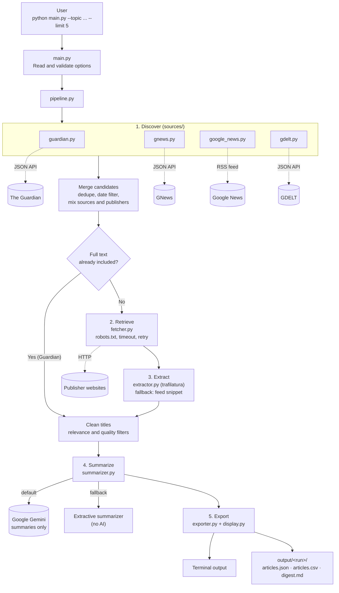

# NewsPulse

**Automated news discovery and summarization from the command line.**

Give NewsPulse a topic, such as *"cybersecurity"*, *"electric vehicles"* or
*"climate change"*. It finds recent news articles from several public sources,
extracts the article text, filters out duplicates and off-topic results, and
writes a short summary of each article with a link back to the original.

```bash
python main.py --topic "cybersecurity" --limit 5
```

> **How AI is used:** all news discovery, retrieval and text extraction is done by
> Python code using public APIs, RSS feeds and HTTP requests. No LLM, chatbot or
> AI search tool is used to find, select, fetch or extract articles. Google
> Gemini is used **only** to summarize text the code has already collected, and a
> built-in non-AI summarizer takes over whenever Gemini is unavailable.

---

## Contents

- [What it does](#what-it-does)
- [How it works](#how-it-works)
- [Architecture](#architecture)
- [Tech stack](#tech-stack)
- [Setup](#setup)
- [Getting the API keys](#getting-the-api-keys)
- [How to run](#how-to-run)
- [Output](#output)
- [Sample run](#sample-run)
- [Running tests](#running-tests)
- [Design notes](#design-notes)
- [Known limitations](#known-limitations)
- [Future improvements](#future-improvements)

---

## What it does

| Requirement | How NewsPulse handles it |
|-------------|--------------------------|
| Topic input | Passed with `--topic`, or asked for interactively if missing |
| Article limit | `--limit` option (default 5) |
| Multiple sources | The Guardian API, GNews API, Google News RSS and GDELT, covering many publishers |
| Recent news | Keeps articles from the last 7 days by default (`--days` to change) |
| Metadata | Title, publisher, URL, publication date, retrieval time and article text |
| Missing data | Stored as `null` and listed in each article's `missing_fields` |
| Summaries | 2–4 sentences per article, based only on the collected text |
| Output | Results in the terminal, plus `articles.json`, `articles.csv` and a readable `digest.md` |
| Reliability | Deduplication, relevance filtering, timeouts, retries and per-source error handling |
| Shortfalls | If fewer articles than requested are found, the output says so and why; nothing is invented |

---

## How it works

Every run goes through six steps.

**1. Input.** Reads the topic, article limit, day range and summarizer choice.

**2. Discover.** Searches four sources for the topic:

| Source | What it provides |
|--------|------------------|
| **The Guardian API** | The Guardian's own articles, with the full text included |
| **GNews API** | Articles from many publishers, with direct links |
| **Google News RSS** | Broad, up-to-date coverage of many publishers |
| **GDELT DOC 2.0 API** | A global news index with direct publisher links |

**3. Retrieve.** For every source except the Guardian (whose API already
includes the text), NewsPulse downloads the article page. Google News redirect
links are first decoded to the real publisher URL. Requests use a clear user
agent, timeouts and a polite delay between calls to the same site, and they
respect `robots.txt`. Paywalls, logins and CAPTCHAs are never bypassed.

**4. Clean.** `trafilatura` extracts the main article text and leaves out menus,
ads and comments. Then NewsPulse:
- drops articles older than the day range;
- drops off-topic results, video and podcast pages, live blogs, academic papers
  and auto-generated stock-price posts;
- removes duplicates by URL and by near-identical headline;
- cleans titles (removes site breadcrumbs, publisher suffixes and broken spacing);
- mixes results across sources and publishers.

If a page can't be fetched, the source's short snippet is used instead and
clearly marked as an excerpt.

**5. Summarize.** Gemini receives only the article's title and extracted text,
and is instructed to write 2–4 sentences using nothing else. If Gemini is busy,
it retries twice; if it's unavailable or out of quota, the extractive summarizer
picks the most important sentences directly from the article.

**6. Export.** Prints the results in the terminal and saves JSON, CSV and a
Markdown digest. Any source that failed is listed with a short reason.

If one source fails or a site blocks a request, the run continues with
everything else.

---

## Architecture



---

## Tech stack

| Tool | Used for |
|------|----------|
| Python 3.10+ | Core language |
| requests | HTTP requests with timeouts and retries |
| feedparser | Reading the Google News RSS feed |
| googlenewsdecoder | Turning Google News redirect links into real publisher URLs |
| trafilatura | Extracting the main article text from web pages |
| RapidFuzz | Detecting near-duplicate headlines |
| Pydantic | Data models and validation |
| google-genai | Gemini summaries |
| Rich | Clear, colored terminal output |
| python-dotenv | Loading API keys from `.env` |
| pytest | Automated tests |

---

## Setup

**You need:** Python 3.10 or newer, and Git.

### 1. Clone the repository

```bash
git clone https://github.com/<your-username>/newspulse-project.git
cd newspulse-project
```

### 2. Create and activate a virtual environment

```bash
python -m venv venv
```

```bash
# Windows (PowerShell or Command Prompt)
venv\Scripts\activate

# macOS / Linux
source venv/bin/activate
```

> On Windows PowerShell, if activation is blocked with a "running scripts is
> disabled" error, run `Set-ExecutionPolicy -Scope CurrentUser RemoteSigned`
> once, then try again.

### 3. Install dependencies

```bash
pip install -r requirements.txt
```

### 4. Create your `.env` file

```bash
# Windows
copy .env.example .env

# macOS / Linux
cp .env.example .env
```

Then add your API keys to it, as explained in the next section.

---

## Getting the API keys

All three keys are **free** and need no credit card. NewsPulse still runs without
them, but each missing key turns off one feature:

| Key | Without it |
|-----|------------|
| `GEMINI_API_KEY` | Summaries use the extractive (non-AI) method |
| `GUARDIAN_API_KEY` | The Guardian source is skipped |
| `GNEWS_API_KEY` | The GNews source is skipped |

### Gemini (summaries)

1. Go to [Google AI Studio](https://aistudio.google.com/apikey) and sign in with a Google account.
2. Click **Create API key** and copy it.

### The Guardian (news source)

1. Go to the [Guardian Open Platform](https://open-platform.theguardian.com/access/)
   and click **Register developer key**. This is the free, non-commercial key.
2. Fill in the short form. For *Reason*, choose **Student project**; for *How will
   content be displayed*, choose **Summary only**.
3. The key is sent to your email within a few minutes. Check your spam folder too.

### GNews (news source)

1. Sign up at [gnews.io](https://gnews.io/) and choose the **Free** plan.
2. Confirm your email if asked, then copy the API key from your **Dashboard**.

### Add the keys to `.env`

Open `.env` in a text editor and paste your keys after the `=` signs, with no
quotes or spaces:

```
GEMINI_API_KEY=your-gemini-key
GEMINI_MODEL=gemini-3.8-flash
GUARDIAN_API_KEY=your-guardian-key
GNEWS_API_KEY=your-gnews-key
REQUEST_TIMEOUT=10
```

Save the file. Keys are only read from this file and never stored in the code.
`.env` is listed in `.gitignore`, so it is never committed; keep it private.

---

## How to run

With the virtual environment active, run:

```bash
python main.py --topic "cybersecurity" --limit 5
```

The results appear in the terminal and are saved to the `output/` folder.
A run usually takes about a minute.

### Options

| Option | Default | Description |
|--------|---------|-------------|
| `--topic` | *(asks if missing)* | Topic or keywords to search for |
| `--limit` | `5` | Maximum number of articles (1–50) |
| `--days` | `7` | Only keep articles from the last N days (1–30) |
| `--summarizer` | `gemini` | `gemini`, or `extractive` for non-AI summaries |
| `--format` | `both` | `json`, `csv` or `both` |
| `--output-dir` | `output` | Where results are saved |
| `--verbose` | off | Show detailed progress logs |

### Examples

```bash
# Ask for the topic interactively
python main.py

# 10 articles from the last 3 days
python main.py --topic "electric vehicles" --limit 10 --days 3

# Non-AI summaries only
python main.py --topic "climate change" --summarizer extractive

# JSON only, with detailed logs
python main.py --topic "renewable energy" --format json --verbose
```

---

## Output

Each run creates its own folder, for example
`output/cybersecurity_2026-11-13T08-42-43Z/`, containing:

| File | Contents |
|------|----------|
| `articles.json` | Full structured results |
| `articles.csv` | The same data as a table |
| `digest.md` | A readable digest with summaries and links to the originals |

### What the terminal and digest show

- **Sources queried:** every source that was tried.
- **Articles from:** only the sources that contributed articles, with counts.
- **Source errors:** any source that failed, with a short reason.
- For each article: title, publisher, date, summary, link, and how the summary
  was made (*Gemini*, or *extractive*). Articles based only on a short excerpt
  are clearly flagged.

### JSON format

Placeholder values:

```json
{
  "topic": "cybersecurity",
  "generated_at": "2026-11-13T08:42:43Z",
  "days": 7,
  "requested_limit": 5,
  "article_count": 5,
  "sources_queried": ["guardian", "gdelt", "gnews", "google_news"],
  "articles_by_source": {"gnews": 4, "google_news": 1},
  "summarizer_requested": "gemini",
  "source_errors": [{"source": "gdelt", "error": "GDELT rate limit reached (HTTP 429)"}],
  "shortfall_note": null,
  "articles": [
    {
      "title": "<title>",
      "source": "<publisher>",
      "url": "https://example.com/article",
      "published_at": "2026-11-12T18:23:00Z",
      "retrieved_at": "2026-11-13T08:42:10Z",
      "discovered_via": "gnews",
      "excerpt": "<extracted article text>",
      "text_type": "full_text",
      "summary": "<grounded summary>",
      "summary_method": "gemini",
      "missing_fields": []
    }
  ]
}
```

| Field | Meaning |
|-------|---------|
| `text_type` | `full_text` (real article prose), `feed_excerpt` (only a short snippet was available) or `none` |
| `summary_method` | `gemini` or `extractive` |
| `missing_fields` | Any field that could not be found, such as `["published_at"]` |
| `articles_by_source` | How many articles each source contributed |
| `source_errors` | Sources that failed during the run, and why |
| `shortfall_note` | Why fewer articles than requested were returned, if that happened |

---

## Sample run

A real sample run is included in [`samples/`](samples/):

```bash
python main.py --topic "cybersecurity" --limit 5
```

- [`samples/digest.md`](samples/digest.md): readable digest
- [`samples/articles.json`](samples/articles.json): structured data
- [`samples/articles.csv`](samples/articles.csv): table

In this run, 5 articles were collected from GNews and Google News. GDELT was
rate-limited and reported as a source error, and Gemini was unavailable at the
time (free-tier quota), so the summaries were produced by the extractive
fallback. Both are recorded honestly in the output.

---

## Running tests

```bash
pytest
```

The tests use saved sample responses in `tests/fixtures/`, so they need no
internet connection or API keys. They cover source parsing and error handling,
URL normalization, deduplication, date, relevance and quality filters, title
cleaning, text extraction, summarizer behavior (including retries and
fallbacks) and the exported files.

---

## Design notes

### Why these sources

| Source | Method | Why |
|--------|--------|-----|
| The Guardian | JSON API | Free, reliable, and returns full article text, so no scraping is needed |
| GNews | JSON API | Free key, searches many publishers, returns direct article links |
| Google News RSS | RSS feed (`feedparser`) | Free and keyless, broad and very up-to-date coverage |
| GDELT DOC 2.0 | JSON API | Free and keyless, global coverage with direct links |

Using four independent sources means NewsPulse keeps working if one is down,
rate-limited or missing a key.

### Responsible collection

- Only publicly accessible pages are fetched.
- `robots.txt` is checked before fetching a page.
- Requests identify the program with a clear user agent and wait between calls
  to the same site.
- Paywalls, logins and CAPTCHAs are never bypassed. Blocked articles are skipped
  or fall back to their snippet, and are flagged.

### Keeping results relevant and clean

- **Relevance:** the topic (or a common short form, such as "EV" for "electric
  vehicles") must appear in the title or the first 500 characters of the article.
- **Quality:** video and podcast pages, live blogs, academic papers and
  auto-generated stock-price posts are skipped. "Full text" must contain real
  sentences, so menus and schedules don't count.
- **Deduplication:** by normalized URL (tracking parameters removed), then by
  near-identical headline, which catches the same story published on several sites.
- **Variety:** results are mixed across sources and publishers.

### Summarization

- **Gemini (default):** the prompt contains only the article's title and extracted
  text, and tells the model to use only facts from that text in 2–4 sentences, at
  a low temperature. Gemini never searches for, selects or fetches articles.
  Requests time out after 30 seconds; busy errors are retried twice, and quota or
  model errors switch the rest of the run to the extractive summarizer.
- **Extractive (fallback, no AI):** scores sentences by word frequency and picks
  the 2–4 most important complete sentences, in their original order. Every
  sentence comes straight from the article, so nothing unsupported can be added.

Each article records which method produced its summary.

---

## Known limitations

- **GDELT rate limiting:** GDELT strictly limits automated requests and often
  returns HTTP 429, even after long waits. When that happens, the run continues
  with the other sources, as in the included sample run.
- **Gemini free tier:** the free quota is small and the service is sometimes busy.
  Affected articles automatically use the extractive summarizer. Model names also
  change over time; set `GEMINI_MODEL` in `.env` if the default is retired.
- **GNews delay:** free-plan results are delayed by about 12 hours, so the very
  newest articles come from Google News.
- **Google News links** are encoded redirects. They're decoded with
  `googlenewsdecoder`, which can break if Google changes the format; the original
  link is kept if decoding fails.
- **Blocked or paywalled sites** are skipped or reduced to a short excerpt.
- **Extractive summaries** are always faithful to the article but can read less
  smoothly, especially when a sentence refers to something explained earlier.
- **Keyword relevance** can miss articles that describe the topic in different words.
- **English only:** sources are queried for English-language results.
- **Run time:** about a minute per run, longer if Gemini needs to retry.

---

## Future improvements

- Group articles about the same story across publishers
- A short "top themes" overview at the start of the digest
- Scheduled runs, such as a daily digest
- Semantic relevance filtering using embeddings instead of keywords
- Fetch articles in parallel to speed up runs
- A lightweight web interface